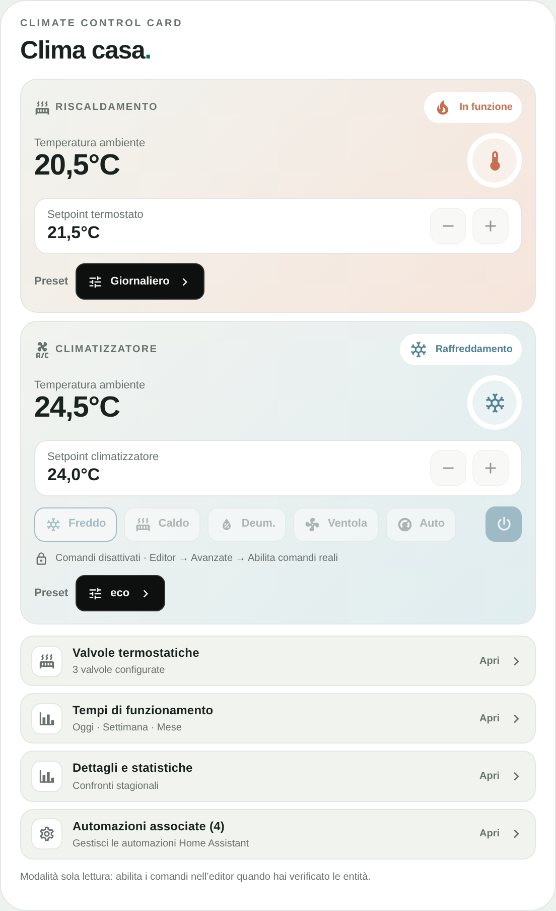
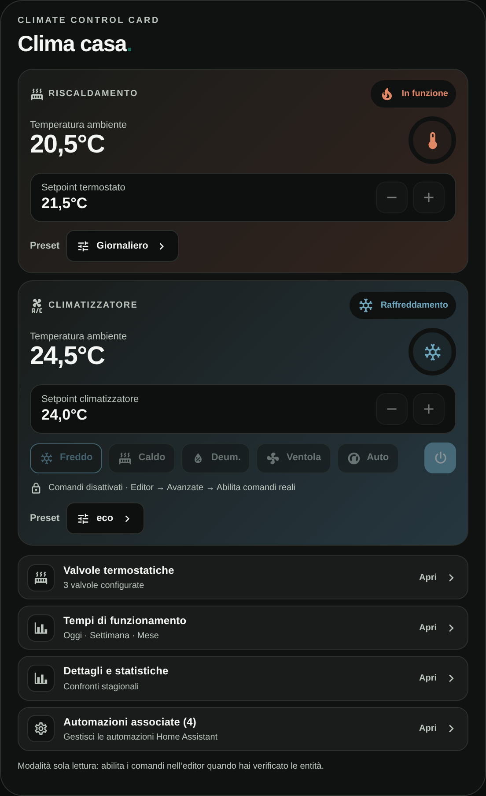
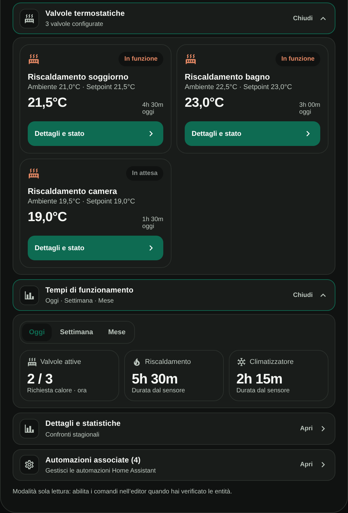

# Climate Control Card

## Overview

**Climate Control Card** is a responsive climate dashboard card for Home Assistant, bringing thermostats, air conditioners, radiator valves, schedules, operating-time information, and automations into a single configurable interface.

Its design follows the Edera Light and Graphite Dark styles. The card works with entities and actions provided by Home Assistant and does not require a dedicated account, paid API, telemetry service, or external JavaScript library.

## Preview

| Light | Dark |
| --- | --- |
|  |  |

*Previews use fictional demo data. Displayed values and available controls depend on the configured Home Assistant entities and theme. The interface text is currently in Italian.*

## Features

- **Modular layout:** Show heating, air conditioning, individual valves, or a custom combination of sections.
- **Climate control:** Display current temperatures and target temperatures, adjust supported setpoints, and select available HVAC modes and presets.
- **Thermostat schedules:** View and choose the actual options exposed by a configured `select.*` entity, without predefined schedule names.
- **Individual valves:** Adjust target temperatures, turn valves off where supported, and restore scheduled operation when a compatible restoration method is configured.
- **Operating-time summaries:** Display today, this week, and this month using the configured duration sensors for heating, air conditioning, and individual valves.
- **Seasonal comparisons:** Configure winter and summer months and compare available historical heating or cooling totals. An optional future scenario is clearly labeled as illustrative.
- **Automations:** Add any number of existing `automation.*` entities, enable or disable them, and optionally assign display names. Home Assistant's friendly name is used when no custom name is provided.
- **Visual editor:** Find, select, replace, or remove entities using Home Assistant selectors; customize displayed sections, titles, temperature controls, and appearance.
- **Edera appearance:** Automatic, Light, and Graphite Dark modes, native Home Assistant Material Design Icons, compact detail dialogs, and responsive layouts.

Available commands depend on the configured integration and device capabilities. A target temperature does not, by itself, confirm that a physical valve is open or that a heat source is running. Information that is not available is not estimated.

## Installation

### HACS (Recommended)

Install Climate Control Card directly from the default HACS catalog.

1. Open **HACS** in Home Assistant.
2. Search for **Climate Control Card**.
3. Select **Climate Control Card** from the results.
4. Click **Download** to install the card.
5. Reload your dashboard if necessary.
6. Add **Climate Control Card** to your dashboard and configure it using the visual editor.

To install a specific release, use **Download** or **Redownload** and select the desired version when available.

### Alternative: Custom repository

If you prefer to add the repository manually:

1. Open **HACS** and select **Custom repositories** from the menu.
2. Enter `https://github.com/luigi-regolo/climate-control-card`.
3. Select **Dashboard** as the repository type and add it.
4. Find **Climate Control Card** in HACS and download it.

### Manual installation

1. Download `dist/climate-control-card.js` from this repository.
2. Copy the JavaScript module to the `www` directory of your Home Assistant configuration.
3. Add `/local/climate-control-card.js` to your dashboard resources as a **JavaScript module**.
4. Reload the dashboard and add the card.

## Configuration / Usage

### Visual editor

The editor provides **Devices**, **Statistics**, **Automations**, **Appearance**, and **Advanced** sections. Select the entities that already exist in your Home Assistant installation; no YAML is required for normal setup.

- **Devices:** Select the thermostat, air conditioner, optional schedule selectors, and individual radiator valves. Add, remove, or rename configured valves.
- **Statistics:** Select the duration sensors for each period and configure winter/summer months and historical seasonal totals.
- **Automations:** Add or remove existing automations. Leave the custom name blank to display its Home Assistant name.
- **Appearance:** Customize the upper heading, card title, Edera theme, visible sections, and temperature adjustment style.
- **Advanced:** Review optional controls and enable real commands only after validating the configured entities.

Real commands are **disabled by default** and require explicit activation in the editor. The card uses Home Assistant actions and permissions; it does not bypass device or platform safeguards.

### Valve controls and schedules

Temperature adjustment is available for compatible `climate.*` entities. The off control is enabled only when the device exposes the corresponding HVAC mode.

**Restore program** is available only when a supported integration-specific restoration action or an existing Home Assistant script has been explicitly configured. This capability is not universal across all thermostat and valve integrations. If no supported restoration method is configured, the control is disabled.

Thermostat schedules and air-conditioning programs or presets are shown only when the selected entities expose them.

### Duration and seasonal statistics

Duration displays require compatible `sensor.*` entities providing hours, minutes, seconds, or a supported duration format. Missing data is shown as **N/D** rather than calculated from a temperature target or valve count.

The selected winter and summer months define the intended comparison periods. Historical sensors must already provide the relevant seasonal totals; changing the selected months does not recalculate or recreate historical data.

The illustrative next-season scenario, when available, is an average of two configured historical values. It is not a weather, heating-demand, or energy-use forecast. Historical availability depends on Home Assistant's data retention and any helper or aggregated sensors configured by the user.

## Compatibility / Requirements

- Home Assistant with support for custom JavaScript dashboard modules and visual card editors.
- Compatible `climate.*`, `select.*`, `sensor.*`, `automation.*`, and optionally `script.*` entities, according to the features used.
- Only device commands and modes actually exposed by the relevant Home Assistant integration are available.

A minimum supported Home Assistant version has not yet been independently validated. Edera is a design reference, not a required theme dependency.

## Releases

See [GitHub Releases](https://github.com/luigi-regolo/climate-control-card/releases) for published versions.

## Copyright & License

Copyright © 2026 luigi-regolo

Original project created and maintained by luigi-regolo.

Licensed under the **GNU General Public License, version 3 only (GPL-3.0-only)**. See [LICENSE](LICENSE) for the complete terms.