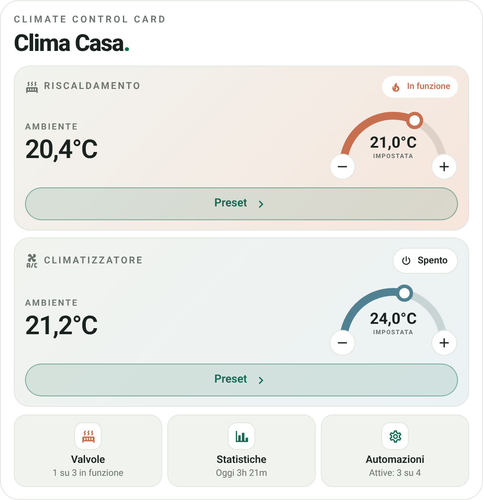
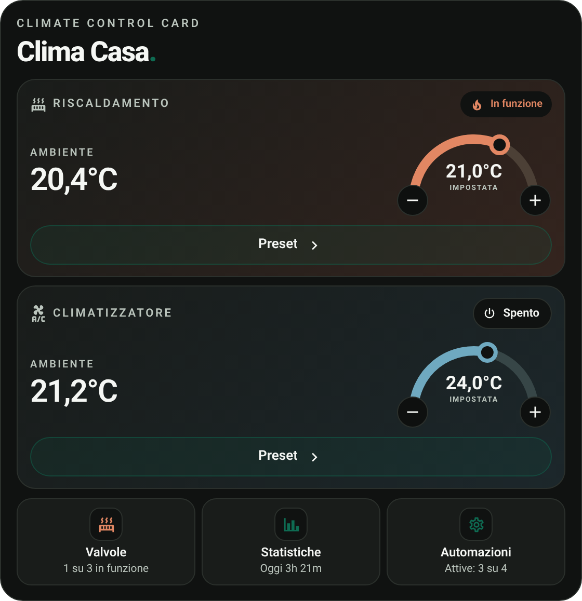
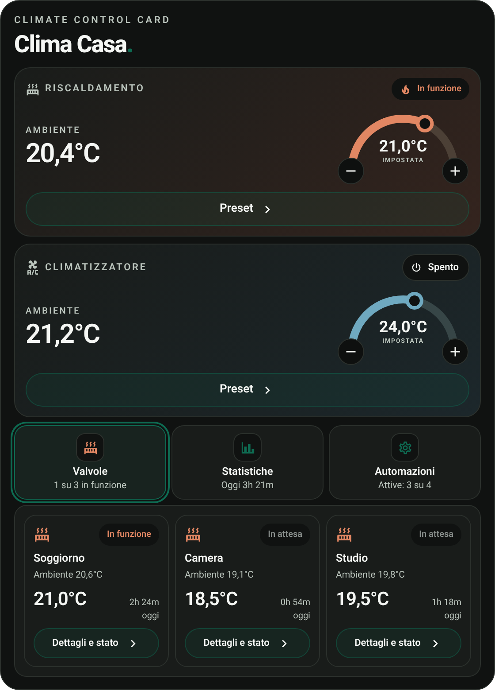
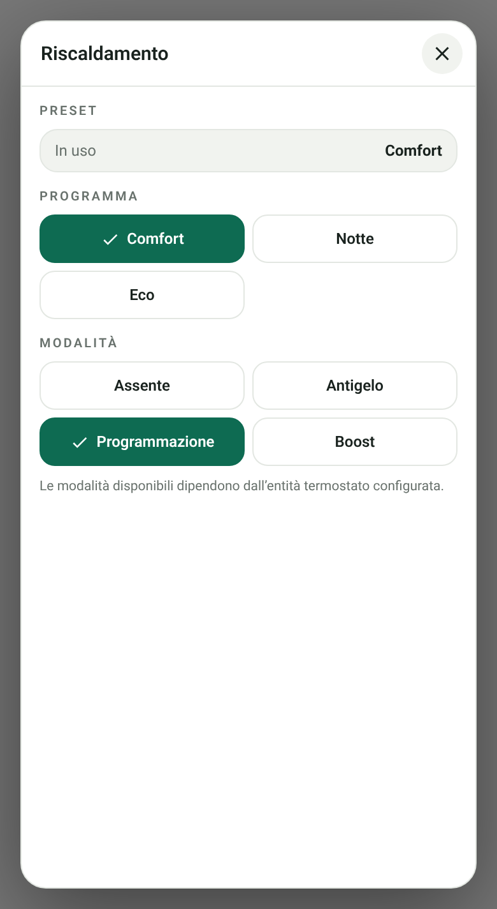
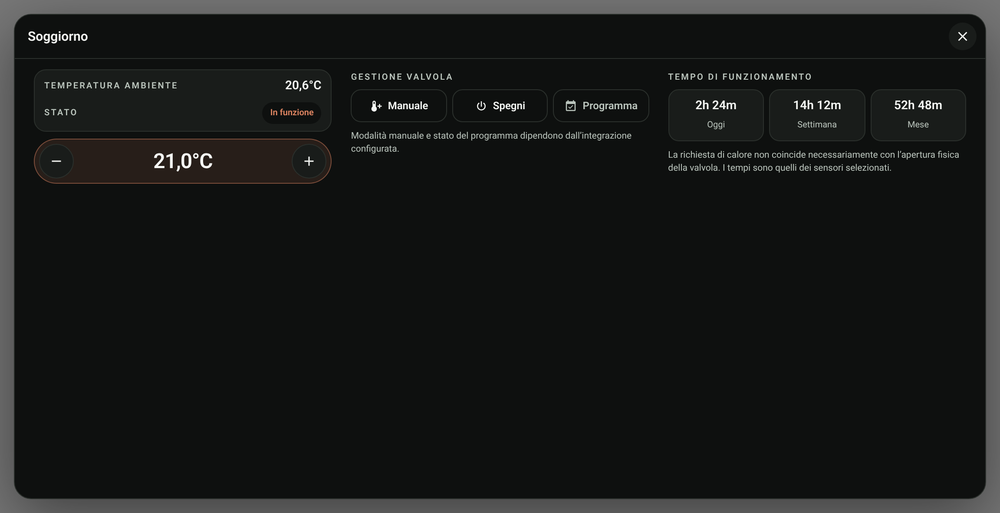
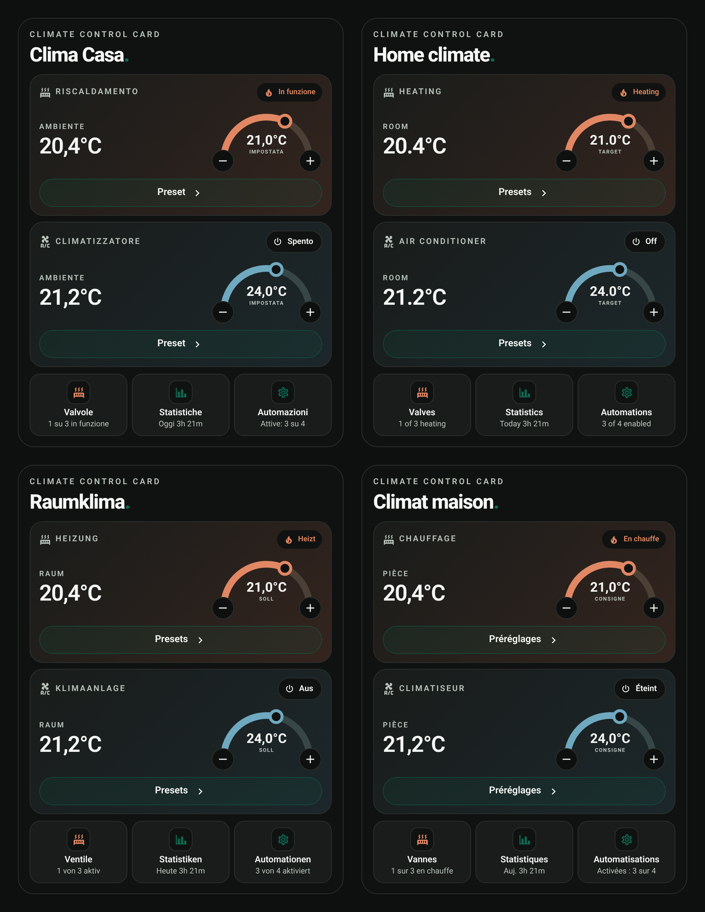

# Climate Control Card

## Overview

**Climate Control Card** is a responsive climate dashboard card for Home Assistant, bringing thermostats, air conditioners, radiator valves, schedules, operating-time information, and automations into a single configurable interface.

Its design follows the Edera Light and Graphite Dark styles. The interface is available in Italian, English, German and French. The card works with entities and actions provided by Home Assistant and does not require a dedicated account, paid API, telemetry service, or external JavaScript library.

## Preview

| Light | Dark |
| --- | --- |
|  |  |

| Phone popup | Tablet and desktop popup |
| --- | --- |
|  |  |

*Previews use fictional demo data, including the four interface languages (Italian, English, German and French). Displayed values and available controls depend on the configured Home Assistant entities and theme.*

## Features

- **Modular layout:** Show heating, air conditioning, individual valves, or a custom combination of sections.
- **Section bar:** Valves, Statistics and Automations appear as compact tiles in a single row, each with a short status line. Tap a tile to open that section below the bar; only one section is open at a time.
- **Climate control:** Display the room temperature and adjust the supported setpoint with a draggable arc (default) or a ring with − and + buttons. Turn the air conditioner on or off from its status badge, and choose available HVAC modes and presets from the **Preset** popup.
- **Last values remembered:** The last set temperature and the last air-conditioner mode are kept in the browser, so the card can show them and restore them when the air conditioner is turned back on. Values reported by Home Assistant always take precedence.
- **Thermostat schedules:** View and choose the actual options exposed by a configured `select.*` entity, without predefined schedule names.
- **Individual valves:** Adjust target temperatures, turn valves off where supported, and restore scheduled operation when a compatible restoration method is configured.
- **Operating-time summaries:** Display today, this week, and this month using the configured duration sensors for heating, air conditioning, and individual valves.
- **Seasonal comparisons:** Configure winter and summer months and compare available historical heating or cooling totals. An optional future scenario is clearly labeled as illustrative.
- **Automations:** Add any number of existing `automation.*` entities, enable or disable them, and optionally assign display names. Home Assistant's friendly name is used when no custom name is provided.
- **Four languages:** Italian, English, German and French. The language follows your Home Assistant profile (English when yours is not available) or can be set in the editor.
- **Visual editor:** Three tabs (Climate, Modules, Appearance). Find, select, replace, or remove entities using Home Assistant selectors and turn each module on or off.
- **Edera appearance:** Automatic, Light, and Graphite Dark modes, native Home Assistant Material Design Icons, and layouts optimized for phones, tablets, and desktops. Popups keep a fixed height: tall and narrow on phones, wide with content in columns on tablets and desktops.

Available commands depend on the configured integration and device capabilities. A target temperature does not, by itself, confirm that a physical valve is open or that a heat source is running. Information that is not available is not estimated.

## Installation

### Marketplace (Recommended)

Install Climate Control Card directly from the default Marketplace catalog in Home Assistant 2026.11 or newer.

1. Go to **Settings** > **Marketplace**.
2. The first time, accept the notice about community content.
3. Use **Search** to find **Climate Control Card**.
4. Open the repository page and select **Install**.
5. Check the version in the dialog and select **Install** again to confirm.
6. Reload your browser to load the new resource.
7. Add **Climate Control Card** to your dashboard and configure it using the visual editor.

### Manual installation

1. Download `dist/climate-control-card.js` from this repository.
2. Copy the JavaScript module to the `www` directory of your Home Assistant configuration.
3. Add `/local/climate-control-card.js` to your dashboard resources as a **JavaScript module**.
4. Reload the dashboard and add the card.

## Configuration / Usage

### Visual editor

The editor has three tabs. Select the entities that already exist in your Home Assistant installation; no YAML is required for normal setup.

- **Climate:** Heating and air conditioner, each with a **Show on the card** switch and its entities (thermostat, schedule selector, presets entity, optional activity sensors). This tab also contains the switch for real commands.
- **Modules:** Thermostatic valves, Run times, Season comparisons and Linked automations. Each module has a **Show on the card** switch; its settings appear when it is on. Add, remove, or rename valves and automations here.
- **Appearance:** Upper label and title (each can be hidden), theme, language, card mode, and temperature control style (arc or ring).

Real commands are **enabled by default**. Turn them off in the **Climate** tab to use the card as read-only. The card uses Home Assistant actions and permissions; it does not bypass device or platform safeguards.

### Language

The card is available in Italian, English, German and French. By default it follows the language of the Home Assistant user profile and uses English when that language is not available. To force a language, choose it in the **Appearance** tab or set the `language` option.

Entity names, schedule options and other texts that come from Home Assistant are shown as they are.

### Valve controls and schedules

Temperature adjustment is available for compatible `climate.*` entities. The off control is enabled only when the device exposes the corresponding HVAC mode.

**Restore program** is available only when a supported integration-specific restoration action or an existing Home Assistant script has been explicitly configured. This capability is not universal across all thermostat and valve integrations. If no supported restoration method is configured, the control is disabled.

Thermostat schedules and air-conditioning programs or presets are shown only when the selected entities expose them.

### Duration and seasonal statistics

Duration displays require compatible `sensor.*` entities providing hours, minutes, seconds, or a supported duration format. Missing data is shown as not available (for example **N/A** in English) rather than calculated from a temperature target or valve count.

The selected winter and summer months define the intended comparison periods. Historical sensors must already provide the relevant seasonal totals; changing the selected months does not recalculate or recreate historical data.

The illustrative next-season scenario, when available, is an average of two configured historical values. It is not a weather, heating-demand, or energy-use forecast. Historical availability depends on Home Assistant's data retention and any helper or aggregated sensors configured by the user.

## Compatibility / Requirements

- Home Assistant with support for custom JavaScript dashboard modules and visual card editors.
- Compatible `climate.*`, `select.*`, `sensor.*`, `automation.*`, and optionally `script.*` entities, according to the features used.
- Only device commands and modes actually exposed by the relevant Home Assistant integration are available.

A minimum supported Home Assistant version has not yet been independently validated. Edera is a design reference, not a required theme dependency.

## Releases

See [GitHub Releases](https://github.com/luigi-regolo/climate-control-card/releases) for published versions.

## Copyright & License

Copyright © 2026 luigi-regolo

Original project created and maintained by luigi-regolo.

Licensed under the **GNU General Public License, version 3 only (GPL-3.0-only)**. See [LICENSE](LICENSE) for the complete terms.
